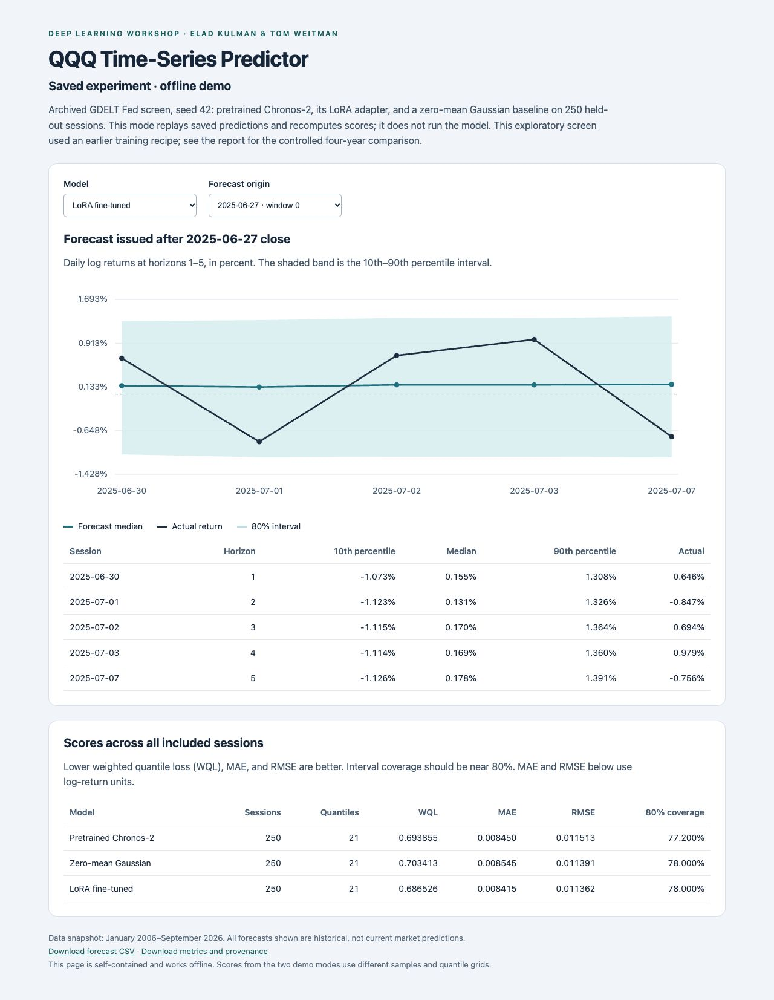

# QQQ Time-Series Predictor

**QQQ daily return forecasting with Chronos-2, LoRA fine-tuning, and news covariates.**

Deep Learning Workshop project by **Elad Kulman and Tom Weitman**. The models predict
one-day log returns at horizons of one to five NYSE trading sessions. The experiments
compare pretrained and fine-tuned models, a Gaussian baseline, and groups of market,
calendar, macroeconomic, and news features.

**Final paper:** [QQQ-Time-Series-Predictor.pdf](docs/QQQ-Time-Series-Predictor.pdf)

## Run the demo immediately

From this folder, with Python 3.11 or 3.12:

```bash
python3 demo.py --open
```

**No installation, API keys, network access, or GPU needed.** This command replays
real saved predictions from the GDELT Fed experiment and recomputes their metrics.
It opens a self-contained HTML page where you can select the model and forecast
origin, inspect five-session forecasts and their intervals, and compare actual returns.
It does **not** run new model inference or training.

If a browser does not open, open `output/demo/saved/index.html` manually. The same
directory contains `forecasts.csv` and `metrics.json`. Omit `--open` on a server.

```bash
python3 demo.py --window 10       # start at another of the 50 saved windows
python3 demo.py --help
```

The saved demo uses an exploratory screen (seed 42, 250 scored sessions, 21 quantiles).
Its historical training recipe differs from the later controlled experiments.
See the [four-year evaluation results](docs/FINETUNED_LADDER_RESULTS.md) for the
controlled comparison. Dates in the demo are historical, not live forecasts.



## Run a fresh model forecast

Create an environment and install the modeling dependencies:

```bash
python3 -m venv .venv
source .venv/bin/activate
python -m pip install --upgrade pip
python -m pip install -r requirements.txt
python demo.py --mode pretrained --open
```

On Windows PowerShell, activate with `.venv\Scripts\Activate.ps1` instead.

This mode runs **actual pretrained Chronos-2 inference on CPU** using 64 context
sessions and the core covariates. It holds out the last five sessions of the bundled
data, writes new forecasts to `output/demo/pretrained/`, and compares them with the
observed returns. Five points demonstrate execution; they are not a reliable evaluation.
This smaller demo uses three quantiles, so its scores should not be compared directly
with the saved demo's scores.

The first model run requires internet access to download `amazon/chronos-2` from
Hugging Face. The revision is pinned to
`29ec3766d36d6f73f0696f85560a422f50e8498c`. Later runs can use the local cache.
No data-provider API keys are needed for the bundled snapshot.

For the tested Python 3.12 package set, add `-c requirements-lock.txt` to the install command.
The lock file records the local macOS environment; hardware-specific wheels may differ.

```bash
python demo.py --mode pretrained --prepare-only  # validate inputs without model weights
python demo.py --mode pretrained --device mps    # optional Apple GPU
python demo.py --mode pretrained --device cuda   # optional NVIDIA GPU
```

For a fully offline machine, first download the model on a connected machine with
`python scripts/download_chronos.py`, copy the resulting cache, and pass the printed
snapshot directory via `python demo.py --mode pretrained --model-id PATH_TO_SNAPSHOT`.

## Training and experiment reproduction

All commands below run from the repository root in the activated environment.

```bash
# Inspect the chronological split and feature roles without loading a model.
python scripts/compare_chronos2_validation.py --smoke-test --prepare-only

# Small pretrained / LoRA / Gaussian comparison (downloads weights on first use).
python scripts/compare_chronos2_validation.py --smoke-test --device-map cpu \
  --model-revision 29ec3766d36d6f73f0696f85560a422f50e8498c

# List the full walk-forward experiment tasks without starting training.
python scripts/run_walk_forward.py --list-tasks
```

The smoke comparison writes adapters, predictions, and metrics under
`models/chronos2-validation-comparison/`. Full LoRA experiments are substantially
more expensive and were run on a GPU cluster. See:

- [Detailed reproduction guide](docs/REPRODUCING.md): data refresh, feature contract,
  pretrained ladder, ablations, and experiment commands.
- [Slurm guide](slurm/README.md): historical cluster setup; adapt account, partition,
  GPU, and scratch paths for your cluster.
- [Data notes](docs/DATA_NOTES.md): source timing, missingness, and limitations.
- [Data inventory](data/README.md): bundled snapshots and optional credentials.
- [Results inventory](docs/results/README.md): saved experiment evidence.

Model weights and trained adapters are not committed. The repository includes the
code and configurations to regenerate them, and saved predictions and metrics for
inspection without training. Historical result metadata records the environment and
source hashes of the original runs; current files are not asserted to be identical
to every historical snapshot.

## Tests

The standalone demo has a dependency-free integration test:

```bash
python3 -m unittest discover -s tests -p test_demo.py -v
```

After installing `requirements.txt`, run all tests and data checks:

```bash
python -m unittest discover -s tests -v
python scripts/validate_feature_table.py
python scripts/audit_processed_data.py --leakage
```

## Repository layout

```text
QQQ-Time-Series-Predictor/
├── demo.py                   # offline replay and fresh-inference entry point
├── demo/                     # self-contained HTML demo template
├── requirements.txt          # modeling, data, and analysis dependencies
├── .env.example              # optional data-refresh credential template
├── configs/                  # news ablation and walk-forward configurations
├── data/
│   ├── raw/                  # cached source data for reproducibility
│   └── processed/            # modeling table, feature roles, calendars, source tables
├── scripts/                  # data pipeline, training, prediction, and evaluation
├── tests/                    # data contract, permutation, and demo checks
├── docs/
│   ├── results/              # archived predictions, metrics, and provenance
│   └── ...                   # experiment findings and reproduction instructions
├── slurm/                    # optional GPU cluster job templates
└── .github/workflows/        # automated demo and regression checks
```

Generated demo output, model downloads, adapters, environments, credentials, caches,
and temporary files are excluded by `.gitignore`.
